<p align="center">
  
</p>

<p align="center">
  <a href="mailto:mohkhanbari@gmail.com"></a>
  <a href="https://wa.me/967775689469"></a>
</p>

<br />

## About me

I'm a full-stack developer at **Data Trans**, building web applications from the database up to the UI. Most of my work is in **ASP.NET Core and C#** on the back end and **React and TypeScript** on the front end, and I care a lot about clean, maintainable architecture.

```csharp
public record Developer
{
    public string   Name         => "Mohammed Khanbari";
    public string   Role         => "Full-Stack Developer @ Data Trans";
    public string   Education    => "B.Sc. Information Technology, Sana'a University";
    public string[] AskMeAbout   => [".NET", ".NET MAUI", "Clean Architecture", "Microservices",
                                     "REST APIs", "React", "GSAP", "SQL"];
    public string[] Learning     => ["Microservices", "Clean Architecture", "Blazor", "Cloud"];
    public string[] Certificates => ["Computer Programming Diploma", "ICDL"];
    public string[] Speaks       => ["Arabic (native)", "English (professional)"];
}
```

<br />

## Tech stack

<p align="center">
  
  <br />
  
</p>

<p align="center"><sub>Also: SQL Server · .NET MAUI · GSAP · REST APIs</sub></p>

<br />

## GitHub activity

<p align="center">
  
  
  <br />
  
</p>

<p align="center"><sub>Cards refresh daily via GitHub Actions.</sub></p>
